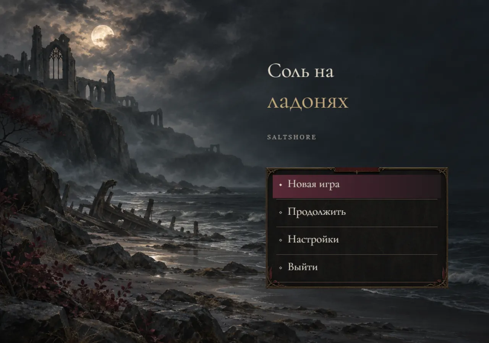
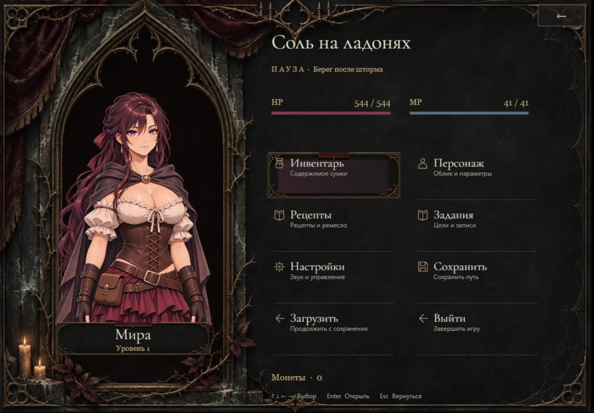
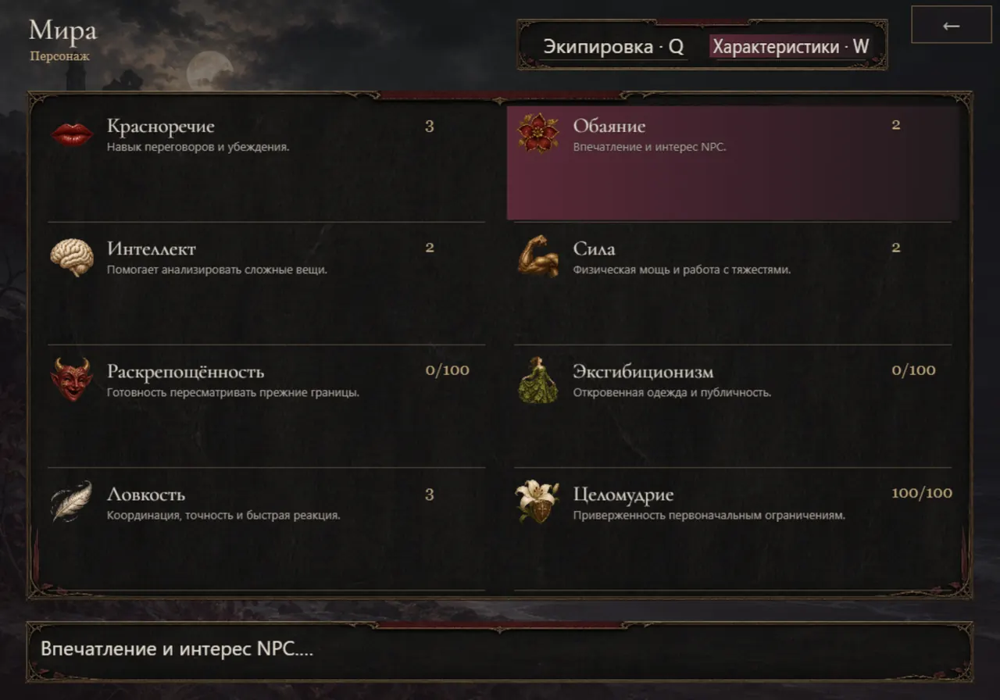
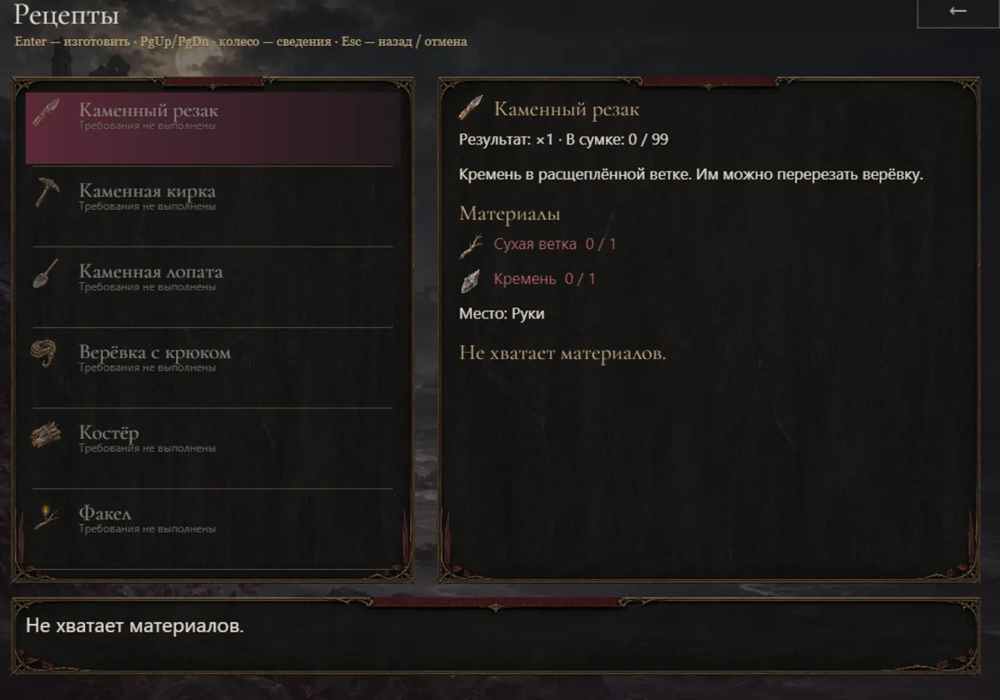
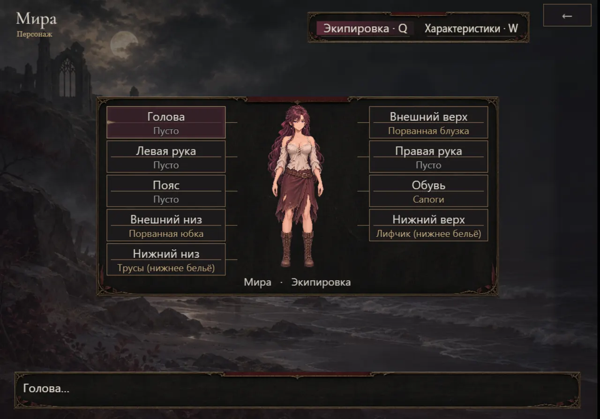

# 🌊 Saltshore | Соль на ладонях

**Dark fantasy · Story-driven 2D RPG · RPG Maker MZ · 18+**

> **Status: active development.** The game currently exists as an internal working prototype. No public build is available yet. This repository is the official public-safe development journal, not a mirror of the source code.

[Russian](README.md) · [Features](#core-features) · [Gallery](#first-screenshots) · [Status](docs/STATUS.md) · [Roadmap](docs/ROADMAP.md) · [FAQ](docs/FAQ.md)

  

## About the game

After a shipwreck, **Mira** finds herself on an unfamiliar island. To survive and move forward, she must explore the coast and ruins, gather resources, meet other characters and make choices that directly affect the story.

Saltshore is an independent story-driven RPG for adults. The project focuses not only on combat, but also on **exploration**, **crafting**, **character relationships**, **meaningful choices**, multiple ways to progress and a gradually unfolding world.

## Core features

- **Crafting and resources.** Recipes, materials and item creation already exist in the prototype.
- **Choices and consequences.** The player shapes Mira's path through the story.
- **Relationship system.** One of the project's core pillars: interactions matter, not just items or battles.
- **Branching narrative.** Multiple routes, story branches and consequences are planned.
- **Different locations.** The island and surrounding world will expand over time.
- **Dark atmosphere.** Mature themes, dark fantasy mood and a stylized visual presentation.

## Confirmed now vs. still growing

| Confirmed in the working prototype | In development / expanding |
| --- | --- |
| Early route: beach → cave → spring | A more complete first chapter and a larger world |
| Basic crafting, recipes and resources | Deeper relationships and fuller narrative branches |
| Character screen, equipment and save/load | Combat system, balancing and broader mechanics |
| Story state, dialogue UI and choices | More characters, locations, professions and factions |
| UI V2, lighting and campfires | More polish, animation and pacing |

## First screenshots

Below are real screenshots from the current working prototype.

### Mira and the in-game menu

*An actual prototype screen showing Mira and the main in-game navigation.*

### Character attributes

*Attributes and behavioral stats are part of the character progression foundation.*

### Crafting and equipment

| Crafting | Character and equipment |
| --- | --- |
|  |  |

## How the project is made

- The **creator** defines game design, artistic direction, priorities and final approvals.
- The workflow uses **ChatGPT**, **OpenAI Codex**, **OpenCode**, plus **ComfyUI**, **local and open models**, and other helper tools for planning, programming, testing, documentation and visual experimentation.
- The **main working repository remains private**. This repo only contains safe updates, approved materials and public-facing development notes. It is **not a source mirror**.

## Development log

- [2026-11-16 — GitHub devlog and first screenshots](devlog/2026-11-16-devlog-and-first-screens.md)
- [2026-11-16 — Welcome](devlog/2026-11-16-welcome.md)
- [2026-11-14 — UI and world interactions](devlog/2026-11-14-ui-and-world.md)
- [2026-11-13 — Story and dialogues](devlog/2026-11-13-story-and-dialogues.md)
- [2026-11-07 — Prototype and crafting](devlog/2026-11-07-prototype-and-crafting.md)

## Download

Not yet available. A verified public build, if released, will appear in the [releases section](releases/README.md) with a version number, changelog and checksum.

---

*Saltshore · independent RPG in development · adults only (18+)*