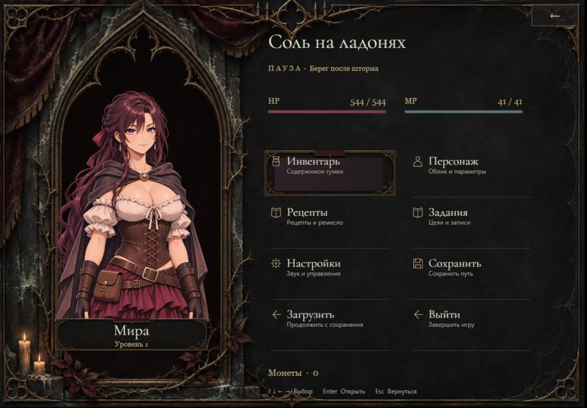
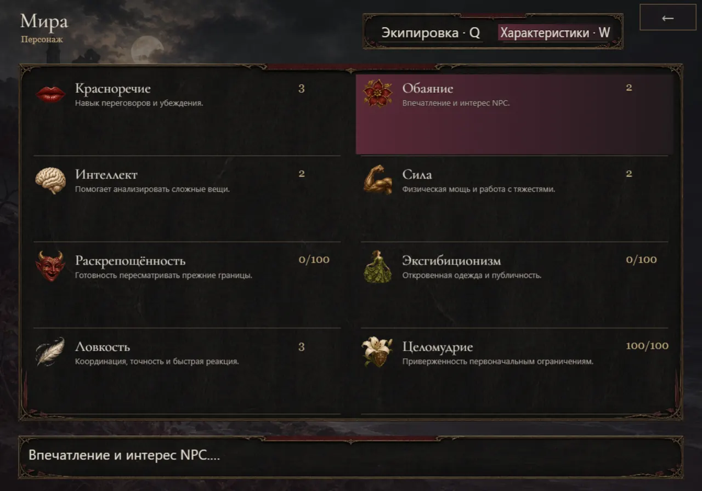
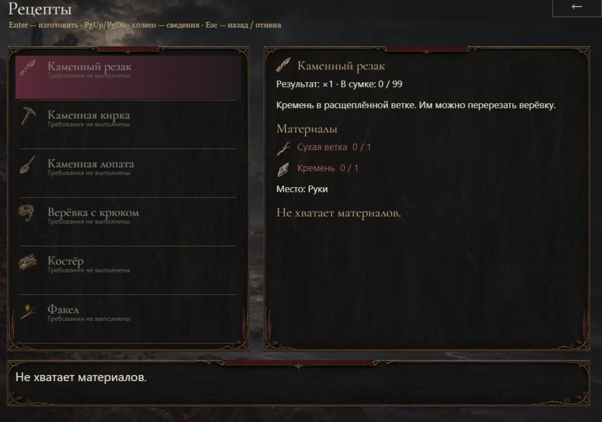

# 🌊 Соль на ладонях | Saltshore

**Dark fantasy · сюжетная 2D RPG · RPG Maker MZ · 18+**

> **Статус: активная разработка.** Сейчас у проекта есть внутренний рабочий прототип. Публичная игровая сборка ещё не выпущена. Этот репозиторий — официальный дневник подтверждённого прогресса и безопасных материалов, а не зеркало исходного кода.

[Об игре](#об-игре) · [Ключевые особенности](#ключевые-особенности) · [Галерея](#первые-скриншоты) · [Дневник](#дневник-разработки) · [Статус](docs/STATUS.md) · [План](docs/ROADMAP.md) · [FAQ](docs/FAQ.md) · [English](README.en.md)

  

## Об игре

После кораблекрушения **Мира** оказывается на незнакомом острове. Чтобы выжить и найти путь дальше, ей предстоит исследовать побережье и руины, добывать ресурсы, знакомиться с другими персонажами и принимать решения, которые прямо влияют на развитие истории.

**Соль на ладонях** — независимая сюжетная RPG для взрослой аудитории. В центре проекта не только сражения, но и **исследование**, **крафт**, **отношения между персонажами**, **нелинейные выборы**, разные способы прохождения и постепенное открытие мира.

## Ключевые особенности

- **Крафт и ресурсы.** Уже в текущем прототипе есть рецепты, материалы и создание предметов.
- **Выборы и последствия.** Игрок сам задаёт траекторию движения Миры по сюжету; решения влияют на дальнейшие события.
- **Система отношений.** Это один из ключевых столпов проекта: важны не только предметы и бой, но и то, как Мира взаимодействует с людьми.
- **Ветвящийся сюжет.** Планируется несколько сюжетных линий, маршрутов и развилок, влияющих на дальнейшее прохождение.
- **Разные локации.** Остров и окружающий мир будут раскрываться постепенно, через новые зоны, персонажей и события.
- **Мрачная атмосфера.** Тон проекта — тёмное фэнтези, взрослая тематика, пиксельная графика и акцент на настроении.

## Что уже подтверждено, а что ещё развивается

| Подтверждено в рабочем прототипе | В разработке / развивается дальше |
| --- | --- |
| Начальный маршрут: побережье → пещера → родник | Полноценная первая глава и расширение мира |
| Базовый крафт, рецепты и ресурсы | Развитая система отношений и наполненные сюжетные ветки |
| Экран персонажа, экипировка, сохранения | Боевая система, баланс и дальнейшие игровые механики |
| Сюжетные состояния, диалоги и выборы | Больше персонажей, локаций, профессий и фракций |
| Интерфейс V2, освещение и костры | Полировка анимаций, темпа и общего пользовательского опыта |

**Важно:** наличие системы в прототипе не означает, что она уже финальная, полная или доступна в публичной сборке.

## Первые скриншоты

Ниже — реальные кадры из текущего рабочего прототипа.

### Меню и портрет Миры

*Портрет Миры и навигация по главным игровым системам. Кадр из рабочего прототипа.*

### Характеристики персонажа

*Характеристики и поведенческие показатели Миры: развитие персонажа влияет на доступные способы взаимодействия.*

### Крафт и экипировка

| Крафт | Экран персонажа и экипировки |
| --- | --- |
|  |  |

## Как развивается проект

- **Автор проекта** определяет геймдизайн, творческие решения, художественное направление, утверждает результаты и задаёт приоритеты развития.
- В работе используются **ChatGPT**, **OpenAI Codex**, **OpenCode**, а также **ComfyUI**, **локальные и открытые модели** и другие вспомогательные инструменты для планирования, программирования, тестов, документации и визуальных экспериментов.
- **Основной рабочий репозиторий приватный.** Здесь публикуются только безопасные обновления, одобренные материалы и подтверждённые результаты. Это **не зеркало исходников**.

## Дневник разработки

| Дата события | Запись | Результат |
| --- | --- | --- |
| [16.11.2026](devlog/2026-11-16-devlog-and-first-screens.md) | Запуск GitHub-дневника и первые скриншоты | Витрина оформлена, добавлены первые реальные изображения из прототипа |
| [16.11.2026](devlog/2026-11-16-welcome.md) | Добро пожаловать | Описание проекта и принципов открытого дневника |
| [14.11.2026](devlog/2026-11-14-ui-and-world.md) | Интерфейс и мир | Принят UI V2 и ряд взаимодействий с игровым миром |
| [13.11.2026](devlog/2026-11-13-story-and-dialogues.md) | Сюжет и диалоги | Принят этап работы над сюжетными выборами и интерфейсом диалогов |
| [07.11.2026](devlog/2026-11-07-prototype-and-crafting.md) | Основы игры | Крафт, ресурсы, квесты и сохранения |

Ранние записи составлены **ретроспективно** по внутреннему журналу. Дата события не всегда совпадает с датой публикации.

## Скачать игру

**Пока недоступно:** первая проверенная публичная версия ещё не опубликована. После релиза здесь появятся официальная ссылка, номер версии, changelog и контрольная сумма. Подробнее: [releases/README.md](releases/README.md).

## Сайт и сообщество

Официальный лендинг готовится отдельно. Когда он будет запущен, здесь появится ссылка. Публичные площадки и сообщества будут добавляться только после их фактического запуска.

---

*Saltshore / Соль на ладонях · независимая RPG в разработке · 18+ · обновлено 16 ноября 2026*