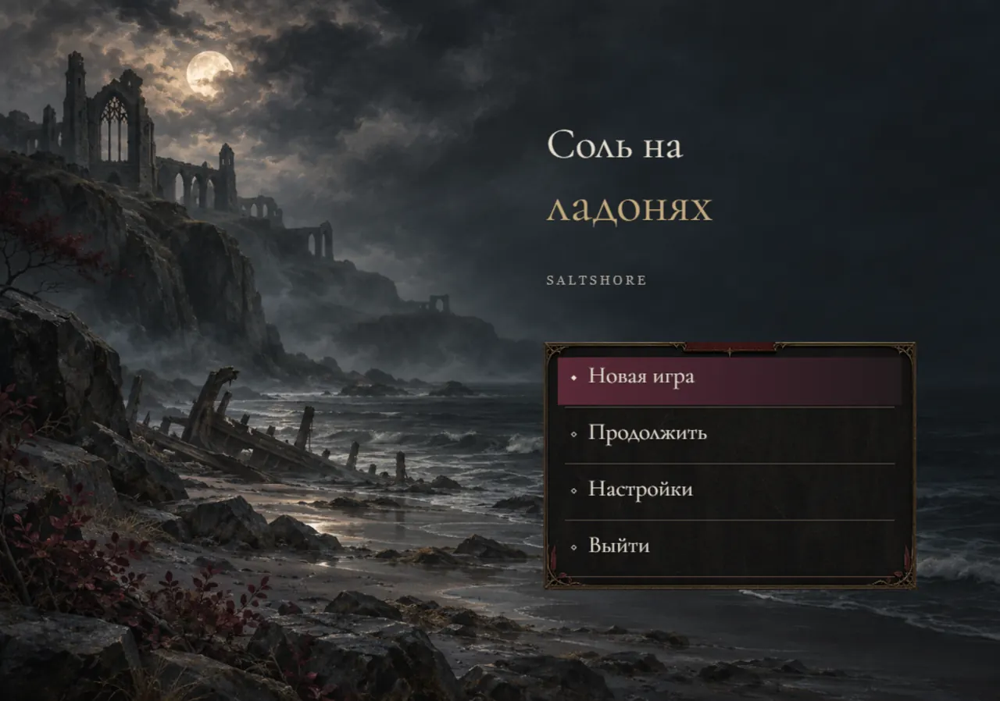
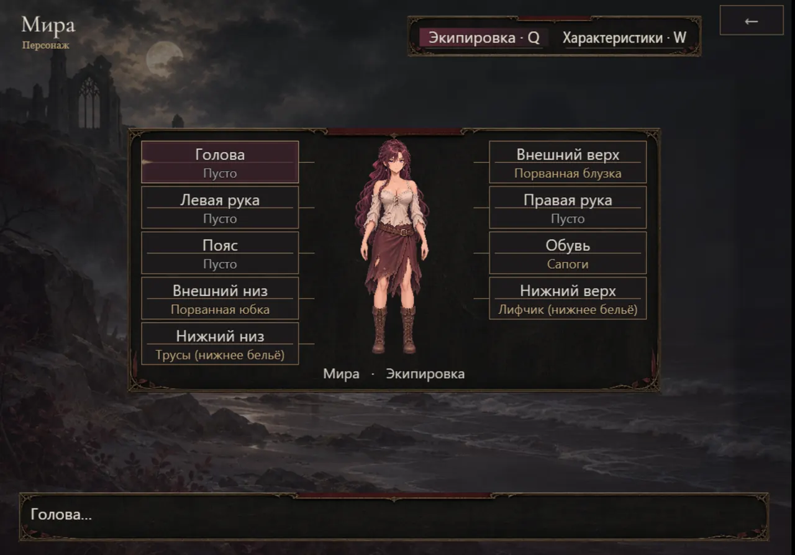

# Saltshore | Соль на ладонях

**English** · [Русский](README.ru.md)

*Story-driven dark fantasy RPG · Ages 18+ · In development*

After a shipwreck, **Mira** finds herself on an unfamiliar island. Exploration, relationships, and player choices will shape the path she takes through its stories.

## Development at a glance

**Completed and reviewed**
- Three opening areas: the shipwreck beach, a cave with a spring, and a forest clearing.
- Early resource gathering, crafting, character and equipment screens.
- An updated interface and the foundations for dialogue and story choices.
- An early combat prototype. It is **not finished**.

**Current focus**
- Bringing the opening areas together into a cohesive experience.
- Improving combat animations and presentation.
- Developing interactions, story scenes, and meaningful choices.

**Planned**
- More locations, quests, and characters.
- Deeper relationships and branching storylines.
- More ways for Mira's decisions to affect the world.

**Release timing:** No public build or release date has been announced. Progress updates will appear here as milestones are completed.

## Development log

| Date | Update |
| --- | --- |
| [November 23, 2026](devlog/2026-11-23-opening-areas.md) | Three opening areas approved; exploration interactions improved |
| [November 22, 2026](devlog/2026-11-22-combat.md) | Early combat prototype reaches a new milestone |
| [November 14, 2026](devlog/2026-11-14-interface.md) | Mira and the game's interface take shape |
| [November 13, 2026](devlog/2026-11-13-story.md) | Dialogue and player-choice foundations |
| [November 7, 2026](devlog/2026-11-07-foundations.md) | First crafting and exploration systems |

## A look at the game

*Screenshots from the current development build. The interface shown is in Russian.*

| Character attributes | Equipment |
| --- | --- |
|  |  |

---

*Last progress update: November 23, 2026.*
