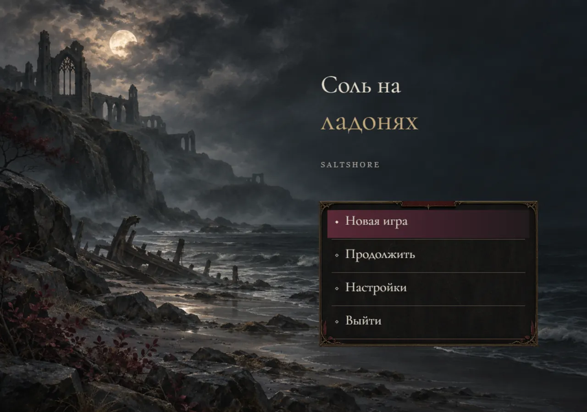
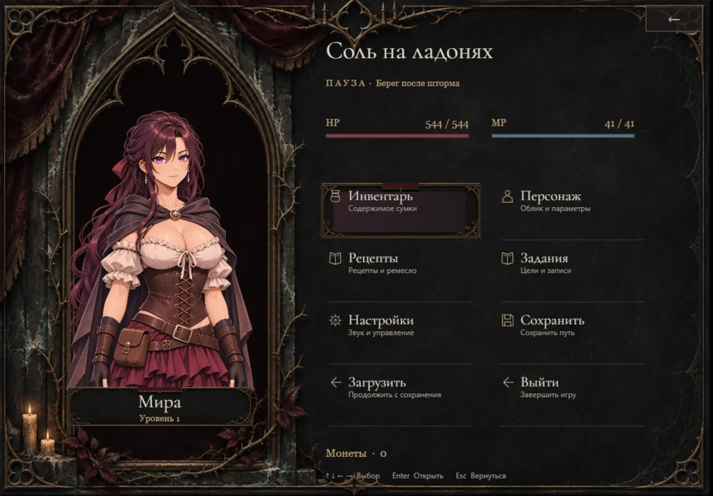
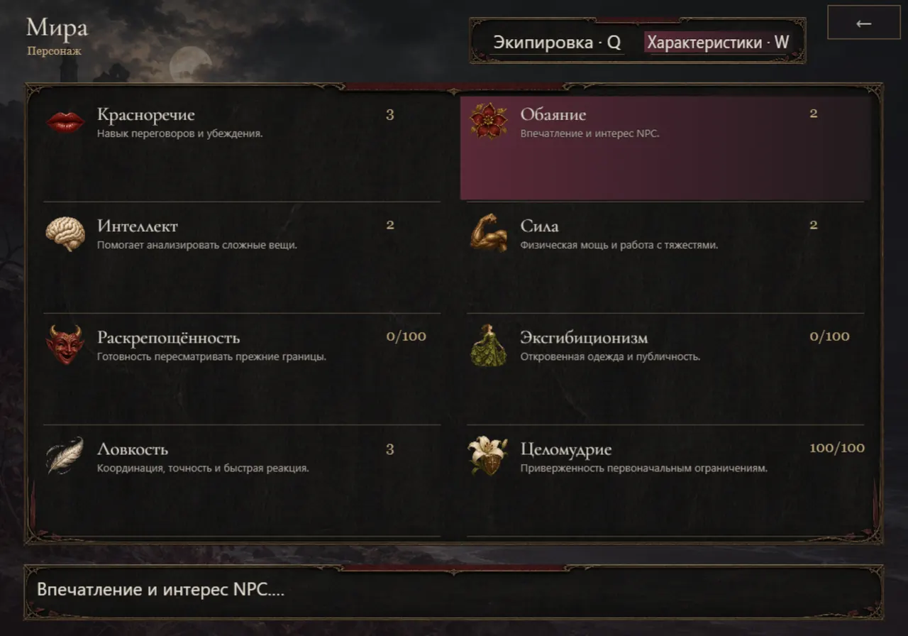
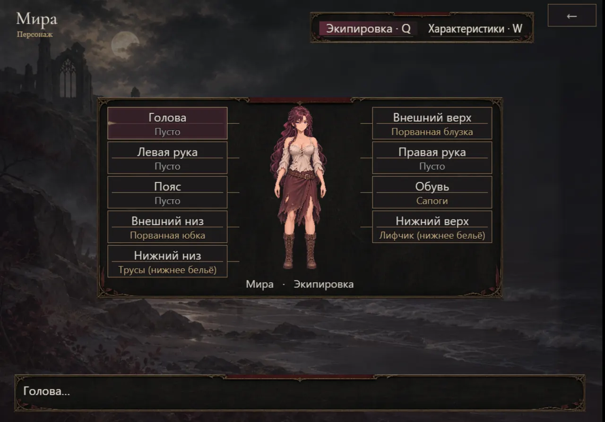
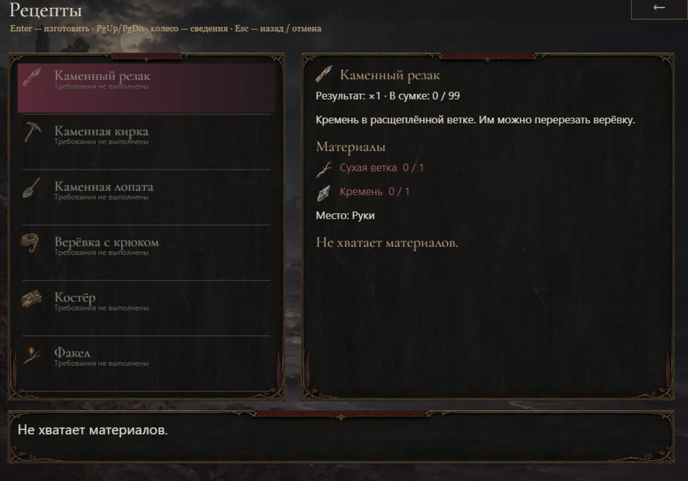

# Соль на ладонях | Saltshore

[English](README.md) · **Русский**

*Сюжетная RPG в жанре тёмного фэнтези · 18+ · В разработке*

После кораблекрушения **Мира** оказывается на неизвестном острове. Исследование, отношения с персонажами и решения игрока будут влиять на её путь и развитие истории.

## Состояние разработки

**Что сделано и принято**
- Три стартовые локации: пляж кораблекрушения, пещера с родником и лесная опушка.
- Базовые механики сбора ресурсов и крафта, экраны персонажа и экипировки.
- Обновлённый интерфейс и основы диалогов и сюжетных выборов.
- Ранний прототип боевой системы. Он **ещё не завершён**.

**Над чем работаем**
- Объединяем стартовые локации в цельное игровое вступление.
- Дорабатываем боевые анимации и визуальную подачу.
- Развиваем взаимодействия, сюжетные сцены и последствия решений.

**Что в планах**
- Новые локации, задания и персонажи.
- Более глубокие отношения и разветвлённый сюжет.
- Больше способов влиять на мир через действия Миры.

**Сроки:** Публичная сборка ещё не выпущена. Дата выхода не объявлена. Здесь будут появляться краткие обновления по завершённым этапам.

## Дневник разработки

| Дата | Обновление |
| --- | --- |
| [23 ноября 2026](devlog/2026-11-23-opening-areas.ru.md) | Приняты три стартовые локации, улучшены взаимодействия |
| [22 ноября 2026](devlog/2026-11-22-combat.ru.md) | Новый этап работы над боевой системой |
| [14 ноября 2026](devlog/2026-11-14-interface.ru.md) | Обновлены Мира и игровой интерфейс |
| [13 ноября 2026](devlog/2026-11-13-story.ru.md) | Основа диалогов и сюжетных решений |
| [7 ноября 2026](devlog/2026-11-07-foundations.ru.md) | Первые системы крафта и исследования |

## Кадры из игры

*Скриншоты текущей версии в разработке.*

| Характеристики | Экипировка |
| --- | --- |
|  |  |

---

*Последнее обновление: 23 ноября 2026 года.*
